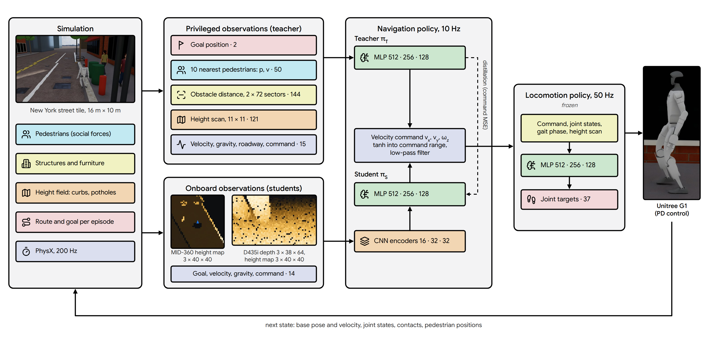
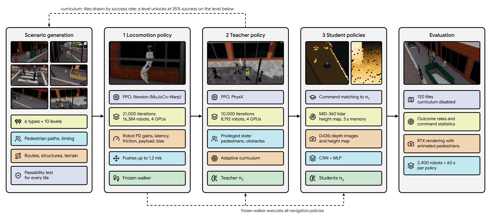

# G1 Patrol: Humanoid Navigation in Dense Urban Pedestrian Environments

Mehmet Kerem Turkcan · [Project page](https://mehmetkeremturkcan.com/g1_patrol/) · [B2-W page](https://mehmetkeremturkcan.com/g1_patrol/b2w/)

This repository contains the simulation environments, training configurations and evaluation tools for goal-directed
navigation of a Unitree G1 humanoid in dense urban pedestrian environments. A procedurally generated suite of New
York City street scenarios (sidewalks, sidewalk sheds, crosswalks, construction zones, doorways and pedestrian
plazas, each at ten difficulty levels) is populated by pedestrians that follow a social-force model. Control is
hierarchical: a locomotion policy tracks velocity commands at 50 Hz, and a navigation policy issues these commands at
10 Hz. A navigation teacher with privileged state is trained with PPO and distilled into student policies that
observe only the robot's onboard sensors (Livox MID-360 lidar or Intel RealSense D435i depth camera). The same
pipeline trains navigation for a Unitree B2-W wheeled quadruped in an indoor lab ([Unitree B2-W](#unitree-b2-w)), and
civic tasks add litter and trash-bag collection, people who need room, incidents and crosswalk signals
([Civic tasks](#civic-tasks)). All experiments are in simulation, using Isaac Lab 3.0 and Isaac Sim 6.1.

The project is part of work toward a civic robot system for the applications of the
[Center for Smart Streetscapes (CS3)](https://cs3-erc.org/), an NSF Engineering Research Center led by Columbia
University. It follows earlier work on street-scene perception:
[SyntheticStreetScenes](https://huggingface.co/datasets/mehmetkeremturkcan/SyntheticStreetScenes), a dataset of
approximately 5,200 generated street-scene videos, and
[StreetPrompt](https://huggingface.co/mehmetkeremturkcan/StreetPrompt), a street-camera video classifier with classes
specified as text.



*Figure 1. Policy architecture. Numbers after the observation terms are input dimensions. The student is trained by
distillation (mean squared error between student and teacher commands); at deployment only the student path is
used.*

## Method

**Control hierarchy.** The navigation policy outputs a velocity command (forward velocity, lateral velocity, yaw
rate) at 10 Hz. The output is mapped into the command ranges by a tanh (forward −0.4 to 1.0 m/s, lateral ±0.15 m/s,
yaw rate ±1.0 rad/s) and low-pass filtered: at each step the command moves halfway to the requested value. A frozen
locomotion policy converts the command into joint position targets for the 37 joints of the G1 at 50 Hz, which are
tracked by PD controllers. The simulator runs at 200 Hz.

**Training.** Training proceeds in three stages; each stage is frozen before the next is trained.

1. *Locomotion policy* (`G1Patrol-Walk-City`). A blind walker. The policy observes only what the robot measures
   (IMU angular velocity and gravity direction, joint positions and velocities), its previous action, the velocity
   command and a gait clock, with sensor noise, sensor biases drawn per episode (IMU mounting ±1.7°, gyroscope
   ±0.02 rad/s, encoder offsets ±0.02 rad; Isaac Lab 3.0's additive-bias noise model adds a new draw to the bias at
   every reset, so that the bias random-walks over episodes, and `g1_patrol.noise` draws it anew), 0–20 ms of
   observation latency and a history of 5 control steps; the critic additionally observes the base velocity and the
   terrain height (asymmetric actor-critic). Leg and ankle joints are explicit PD controllers at the gains used on the
   robot (hip 100, knee 150, ankle 40 Nm/rad) with the motors' torque and speed limits and 0–20 ms of actuation
   latency. Randomized per robot: ground friction (0.3–1.2),
   a torso payload (−1 to +5 kg) and center of mass (±3 cm), leg link masses (±10%), PD gains (±15%), torque limits
   (80–100% of rated, per joint), joint friction and armature; the robot is pushed every 4–8 s. Terrain: curbs and
   steps up to 20 cm, sills, potholes, broken pavement, cobblestones and ramps. Rewards: velocity tracking, a gait
   clock, foot clearance and posture, with penalties on mechanical power, foot impacts, stumbling against edges,
   changes of the joint targets and drift (the lateral-velocity and yaw-rate tracking errors, low-pass filtered over
   1 s and squared; the exponential tracking rewards hardly distinguish a sustained sideways drift of 0.1 m/s from the
   sway of the gait). Commands are resampled every 10 s: forward velocity −0.5 to 1.1 m/s, lateral ±0.3 m/s, yaw rate
   ±1.2 rad/s; 15% of the robots are commanded to stand. Pushes change the base velocity by up to 1.2 m/s. The ground
   has friction 0.1, combined by maximum: MuJoCo-Warp uses the larger friction coefficient of the two bodies in
   contact (PhysX multiplies them), so the contact friction is the robot's randomized value in both simulators. The
   policy is trained from scratch in three phases: 10,000 iterations with narrower randomization (friction 0.6–1.2, no
   payload, rated torque limits, actuation latency up to 10 ms, no sensor biases; push strength ramped from 0.5 to
   1.2 m/s); 8,000 iterations with the settings above on ground of friction 1.0, so that the contact friction is at
   least 1.0 (push strength ramped again); and 3,000 iterations on the low-friction ground.
2. *Teacher* (`G1Patrol-Navigate-NYC`). Navigation with privileged observations: goal position, base velocities,
   gravity vector, positions and velocities of the 10 nearest pedestrians, obstacle distances in 72 sectors (separately
   for tall and low obstacles), a terrain height scan and the current command (332 dimensions). The teacher is
   trained from scratch with PPO for 10,000 iterations with the rewards of Table 2, the curriculum below and a discount
   factor of 0.995 (a 20 s horizon at 10 Hz), executing the frozen locomotion policy of stage 1.
3. *Students* (`G1Patrol-Navigate-NYC-Lidar`, `G1Patrol-Navigate-NYC-Camera`). Distilled from the teacher with
   DAgger-style rollouts of the student for 1,500 iterations each; the loss is the mean squared error between the
   tanh-mapped actions of student and teacher. Each student observes proprioception, the goal position and one sensor
   at its mounting pose in the G1 URDF. The sensor's returns are accumulated into a height map (8 m × 8 m, 0.2 m cells, robot-centred and
   heading-aligned): returns are binned into a world-aligned grid that moves with the robot, using the simulated robot
   motion with a random-walk error (5 mm and 0.002 rad per control step) as odometry, and a cell is cleared 3 s after it
   was last observed. The policy receives the accumulated map,
   the current scan and the previous scan (3 × 40 × 40). The camera student additionally receives the last three
   64 × 38 depth images; depth returns include distance-dependent noise, missing pixels and random occlusions.



*Figure 2. Training workflow.*

| | Locomotion policy | Teacher | Students |
|---|---|---|---|
| Algorithm | PPO | PPO | Distillation (MSE of tanh-mapped actions) |
| Simulator | Newton (MuJoCo-Warp) | Isaac Sim PhysX | Isaac Sim PhysX |
| Policy rate | 50 Hz | 10 Hz | 10 Hz |
| Parallel robots | 16,384 | 8,192 | 8,192 |
| Rollout length (steps per robot and iteration) | 24 | 32 | 32 |
| Iterations | 10,000 + 8,000 + 3,000 | 10,000 | 1,500 per student |
| Entropy coefficient | 0.008 | 0.001 | – |
| Network | MLP 512-256-128 (actor and critic) | MLP 512-256-128 | CNN 16-32-32 per image input, MLP 512-256-128 |
| Hardware, time | 4 GPUs, 1.9 h + 1.5 h + 0.7 h | 4 GPUs, 15.5 h | 4 GPUs, 2.8 h (lidar) + 2.5 h (camera) |

*Table 1. Training setup (NVIDIA RTX PRO 6000 GPUs).*

**Environment.** The terrain is a grid of 16 m × 10 m tiles; columns are the six scenario types and rows are ten
difficulty levels. Building fronts, solid in the simulation, bound every tile along its long edges. In each episode
the robot must traverse a route on its tile within 40 s. Pedestrians are
kinematic bodies that follow walking paths under a social-force model. A path leads from where people enter the
scene (45 m beyond the tile's ends, out of a shop door, up a subway stairwell) to 45 m beyond the tile's ends, so
pedestrians do not appear or disappear in view. Most are timed to reach the robot's route when the robot does; none
starts within 1.5 m of the robot, or within 5 m while walking towards it. A fraction of them (90% at level 1, 60% at
level 10) perceive the robot, keep a clearance of at least 0.1 m, slow down and step around it; the loss of pedestrian speed is penalized, which rewards yielding. The
others react only within 1 m. A unit test verifies that every route admits a 0.6 m wide path at every difficulty.

**Curriculum.** The curriculum keeps an exponential moving average of the success rate on each tile. A level is
unlocked once the next-easier level of the same tile column reaches 35% success. When an episode ends, the robot's
next tile is drawn with a uniformly random scenario type and a level drawn from the unlocked levels with probability
proportional to s(1 − s) + 0.02, where s is the tile's success rate; this concentrates training on levels the policy
solves about half of the time. A fifth of the draws are uniform over the unlocked levels and 15% uniform over all
levels. The same curriculum is used for distillation, where it follows the student's success rate.

| Term | Definition | Weight |
|---|---|---|
| Progress | Reduction of distance to the goal per second, clipped to ±1.0 m/s | 2.0 |
| Goal reached | Within 0.5 m of the goal (terminates) | 100 |
| Pedestrian contact | Robot footprint (radius 0.25 m) or an arm or hand link (radius 0.04 m) intersects a pedestrian (radius 0.25 m) (terminates) | −200 |
| Obstacle contact | Robot footprint, or an arm or hand link within the structure's height range, intersects a structure (terminates) | −150 |
| Fall | Torso contact with the ground (terminates) | −200 |
| Roadway | Robot enters the roadway outside a crosswalk (terminates) | −150 |
| Social speed | Planar speed above 0.3 m/s within 0.3 m of a pedestrian, rising linearly to 1.0 m/s at 1.5 m (m/s) | −6 |
| Personal space | Penetration of a 0.8 m clearance to the nearest pedestrian (m) | −6 |
| Collision risk | Predicted close passes within 2 s under constant relative velocity: (1 − d/0.8 m)(1 − t/2 s) per pedestrian, with t and d the time and center distance of closest approach | −4 |
| Obstacle margin | Penetration of a 0.3 m margin to the nearest structure (m) | −10 |
| Obstacle speed | Planar speed above 0.4 m/s within 0.1 m of a structure, rising linearly to 1.0 m/s at 0.4 m (m/s) | −2 |
| Pedestrian delay | Total speed lost by pedestrians slowing for the robot (m/s) | −1 |
| Curb margin | Penetration of a 0.3 m margin to the roadway (m) | −10 |
| Command rate | Squared change of the velocity command between control steps | −2.0 |
| Lateral command | Squared lateral velocity command | −1.5 |
| Backward command | Squared negative part of the forward velocity command | −2.0 |
| Yaw-rate command | Squared yaw-rate command | −0.15 |
| Policy output | Squared norm of the policy output before the tanh | −0.01 |

*Table 2. Reward terms of the navigation policy, multiplied by the control period (0.1 s). The robot model has no
collision geometry on its arms, and its hands swing beyond the 0.25 m footprint; contacts of the arm and hand links
are therefore checked separately.*

## Results

All navigation policies are evaluated with the curriculum disabled and robots distributed uniformly over all 120
tiles (2,400 robots, 60 s of simulated time, PhysX, sensor noise on); random pushes are disabled. An episode ends at
the goal, at the first contact with a pedestrian or a structure, when the robot enters the roadway outside a
crosswalk, on a fall, or after 40 s.

<!-- table:outcomes -->
| Outcome | Teacher | Lidar student | Camera student |
|---|---:|---:|---:|
| Goal reached | 63.8% | 64.2% | 59.2% |
| Pedestrian contact | 8.1% | 13.1% | 16.2% |
| Obstacle contact | 18.7% | 15.3% | 17.3% |
| Roadway (left the sidewalk or crosswalk) | 3.1% | 1.1% | 0.4% |
| Fall | 0.22% | 0.10% | 0.04% |
| Time-out (40 s) | 6.0% | 6.1% | 6.8% |
| Mean time to goal (successful episodes) | 18.6 s | 18.4 s | 18.5 s |
| Time within 0.5 m of a pedestrian | 3.9% | 6.6% | 8.4% |
| Completed episodes | 6,768 | 6,760 | 6,903 |
<!-- /table:outcomes -->

*Table 3. Episode outcomes over all tiles.*

<!-- table:scenarios -->
| Scenario | Easy (levels 1–4) | Medium (5–7) | Hard (8–10) |
|---|---:|---:|---:|
| Sidewalk | 89 / 91 / 95% | 68 / 71 / 68% | 17 / 16 / 20% |
| Sidewalk shed | 97 / 90 / 93% | 43 / 40 / 45% | 12 / 14 / 10% |
| Crosswalk | 89 / 91 / 92% | 43 / 38 / 36% | 37 / 49 / 52% |
| Construction zone | 86 / 79 / 79% | 56 / 45 / 26% | 8 / 12 / 4% |
| Doorway | 87 / 89 / 77% | 70 / 73 / 50% | 54 / 57 / 46% |
| Plaza | 87 / 88 / 85% | 79 / 76 / 67% | 66 / 76 / 72% |
<!-- /table:scenarios -->

*Table 4. Success rate by scenario type and difficulty (teacher / lidar student / camera student).*

The lidar student matches the teacher's success rate (64.2% against 63.8%); the camera student reaches 59.2%. Both
students leave the roadway less often than the teacher (1.1% and 0.4% against 3.1%) but touch pedestrians more often
(13.1% and 16.2% against 8.1%). Success is 77–97% on easy tiles of every type and 4–20% on hard sidewalk,
sidewalk-shed and construction tiles, where walkways of about 1.0–1.8 m carry two-way foot traffic: on hard
sidewalk-shed tiles 46–64% of the episodes end at a structure, and on hard construction tiles 55–75% time out while
the robot waits for a gap.

**Failure analysis.** The robot's state was recorded at every episode end of the teacher (`analyze_terminations.py`,
2,410 episodes). Of the 1,173 structure contacts, 44% are on sidewalk-shed tiles, against the scaffold posts, the
facade or stacked lumber; structure contacts happen at a median speed of 0.69 m/s and with a pedestrian within 0.3 m
in 5% of them. Pedestrian contacts happen at lower speed (median 0.42 m/s), 41% of them on crosswalks. On crosswalk
tiles of level 7, 101 of the 126 structure contacts happen within 2 s of the episode start, against a bollard between
the start of the route and the curb.

<!-- table:motion -->
| Quantity | Teacher | Lidar student | Camera student |
|---|---:|---:|---:|
| Forward command (m/s) | 0.54 | 0.55 | 0.52 |
| \|Lateral command\| (m/s) | 0.08 | 0.05 | 0.04 |
| \|Yaw-rate command\| (rad/s) | 0.26 | 0.19 | 0.17 |
| Time with \|yaw-rate command\| > 0.8 rad/s | 5.1% | 0.8% | 0.2% |
| Requested command at a range limit | 23.0% | 3.5% | 1.2% |
| Backward command | 14.2% | 7.3% | 6.0% |
| Yaw-rate command change (rad/s²) | 1.01 | 0.42 | 0.38 |
| Planar speed (m/s) | 0.58 | 0.55 | 0.52 |
| Torso tilt | 2.6° | 2.5° | 2.5° |
| Knee flexion | 35.4° | 35.0° | 34.8° |
<!-- /table:motion -->

*Table 5. Velocity commands and posture during the evaluation (time averages). A requested command is at a range
limit when it lies within 5% of the range of a command component (average over the three components); a backward
command is a forward command below −0.05 m/s.*

The lateral command stays small (0.04–0.08 m/s on average). The teacher requests a range limit 23% of the time and
changes its yaw-rate command more than twice as fast as the students (1.01 against 0.38–0.42 rad/s²); all policies
command backward motion part of the time (6–14%).

<!-- table:walker -->
| Metric | Walker, Newton | Walker, navigation commands | Walker, PhysX |
|---|---:|---:|---:|
| Forward velocity error (m/s) | 0.076 | 0.074 | 0.080 |
| Lateral velocity error (m/s) | 0.075 | 0.069 | 0.081 |
| Yaw-rate error (rad/s) | 0.118 | 0.117 | 0.138 |
| Torso tilt | 2.6° | 2.4° | 2.6° |
| Knee flexion | 34.4° | 33.2° | 34.8° |
| Pelvis height (m) | 0.719 | 0.719 | 0.719 |
| Leg mechanical power (W) | 77 | 65 | 88 |
| Change of joint targets per step (rad) | 0.044 | 0.041 | 0.045 |
| Torso roll and pitch rate (rad/s) | 0.27 | 0.24 | 0.28 |
| Falls in 341 robot-minutes | 10 | 3 | 15 |
<!-- /table:walker -->

*Table 6. Locomotion policy on city terrain with the training randomization (payload, torque limits, latencies,
friction, sensor noise and biases): 1,024 robots for 20 s each on 200 random terrain tiles, random velocity commands
from the training ranges or, in the second column, from the navigation policy's ranges. Tracking errors are mean
absolute errors; the other quantities are time averages. The walker is trained on Newton; PhysX is a second simulator
it was not trained on.*

On PhysX the tracking errors are 5–17% larger than on Newton and the walker falls 15 times against 10. Under a
constant straight command it drifts sideways by 0.03–0.05 m/s (1 s averages), 0.10–0.20 m within 3 s, and its heading
changes by 0.10 rad (Table 7).

<!-- table:drift -->
| Straight command | Walker | No drift penalty | Ground friction 1.0 |
|---|---:|---:|---:|
| 0.3 m/s, lateral drift (m/s) | 0.034 | 0.042 | 0.043 |
| 0.3 m/s, lateral offset after 3 s (m) | 0.10 | 0.12 | 0.12 |
| 0.3 m/s, heading change after 3 s (rad) | 0.10 | 0.10 | 0.10 |
| 0.6 m/s, lateral drift (m/s) | 0.043 | 0.046 | 0.042 |
| 0.6 m/s, lateral offset after 3 s (m) | 0.16 | 0.17 | 0.15 |
| 0.6 m/s, heading change after 3 s (rad) | 0.10 | 0.11 | 0.11 |
| 0.9 m/s, lateral drift (m/s) | 0.048 | 0.051 | 0.042 |
| 0.9 m/s, lateral offset after 3 s (m) | 0.20 | 0.23 | 0.17 |
| 0.9 m/s, heading change after 3 s (rad) | 0.10 | 0.11 | 0.11 |
<!-- /table:drift -->

*Table 7. Drift under a constant straight command (PhysX, 256 robots per speed, after 1 s of settling). Lateral drift
is the mean absolute 1 s average of the heading-frame lateral velocity; the offset is measured from the line the robot
started on. The ablations are trained with the recipe of the walker and one change each (`5_ablations.sh`): without
the drift penalty, and with Isaac Lab's default ground material (friction 1.0, multiplied) in every phase, so that on
Newton the contact friction is never below 1.0.*

<!-- table:walker_stress -->
| Condition (every robot) | Walker, Newton | Walker, PhysX | No drift penalty, Newton | No drift penalty, PhysX | Ground friction 1.0, Newton | Ground friction 1.0, PhysX |
|---|---:|---:|---:|---:|---:|---:|
| Training randomization | 8 | 15 | 4 | 9 | 11 | 6 |
| Torso payload +5 kg | 15 | 17 | – | – | – | – |
| Torque limits 80% of rated | 9 | 16 | – | – | – | – |
| Actuation latency 15–25 ms | 8 | 19 | – | – | – | – |
| Friction 0.3 (static) / 0.25 (dynamic) | 53 | 52 | 60 | 58 | 281 | 309 |
| Twice the sensor noise and biases | 16 | 18 | – | – | – | – |
| All of the above | 199 | 184 | 220 | 215 | 540 | 631 |
<!-- /table:walker_stress -->

*Table 8. Falls in 341 robot-minutes (setup of Table 6) with every robot at, or beyond, the edge of the training
randomization. Counts from separate runs of the same condition differ by about their square root (Table 6 and the
first row of Table 8 are separate runs).*

At the edges of the training randomization the walker falls at most twice as often as under the training
randomization, except on friction 0.3 (52–53 falls, about one every 6.5 robot-minutes) and with all conditions
combined (184–199 falls, about one every 2 robot-minutes). Without the drift penalty the walker's lateral offset after
3 s at 0.9 m/s is 0.23 m instead of 0.20 m and it falls about 10% more often with all conditions combined. With the
default ground material it never trains on low friction: it falls 5–6 times as often on friction 0.3 (281–309 falls)
and about three times as often with all conditions combined.

<!-- table:nav_stress -->
| Condition | Teacher | Lidar student | Camera student |
|---|---:|---:|---:|
| Nominal (Table 3) | 63.8 / 8.1 / 18.7 / 0.2 | 64.2 / 13.1 / 15.3 / 0.1 | 59.2 / 16.2 / 17.3 / 0.0 |
| Sensors: twice the noise and odometry drift, 0–200 ms height-map latency | – | 62.7 / 13.5 / 16.4 / 0.1 | 56.0 / 17.0 / 17.0 / 0.0 |
| Pedestrians: 20% faster, 30% fewer notice the robot | 56.2 / 18.9 / 17.8 / 0.1 | 54.0 / 27.1 / 13.4 / 0.0 | 47.2 / 33.0 / 13.8 / 0.0 |
| Robot: +5 kg, torque 80%, 15–25 ms actuation latency, friction 0.3 | 58.7 / 8.3 / 21.3 / 1.7 | 60.8 / 13.8 / 16.8 / 1.3 | 56.5 / 17.2 / 17.9 / 0.9 |
<!-- /table:nav_stress -->

*Table 9. Navigation under degraded conditions applied to every robot: goal reached / pedestrian contact / obstacle
contact / fall (%). The teacher observes privileged state, so the sensor condition does not apply to it.*

Doubling the sensor noise and odometry drift and delaying the height map by up to 200 ms costs the lidar student 1.5
and the camera student 3.2 points of success. Faster pedestrians, fewer of whom notice the robot, raise pedestrian
contacts from 8–16% to 19–33%. The degraded robot (payload, weak motors, latency, friction 0.3) costs 3–5 points of
success, and falls rise to 1–2%.

## Civic tasks

The civic task (`G1Patrol-Navigate-Civic`) extends the street task with what a robot on patrol meets besides the crowd
and with work along the way. The same scenario tiles gain litter baskets, curbside piles of trash bags, lines of people
and, at crosswalks, pedestrian signals; each episode (60 s) places litter, bags, people who need room and at most one
incident. Frequencies, speeds and forces grow with the difficulty level.

**Robot.** The navigation policy commands a reaching walker (`G1Patrol-Walk-Reach`) with a velocity and a posture
(pelvis height above the ground and forward lean). The walker drives the legs only; the waist, arms and hands follow a
hands controller. It is trained like the street walker (three phases, Newton) with posture commands (pelvis 0.40–0.72 m
with a coupled lean up to 1.2 rad, half of them deep squats; a braced stance), random upper-body motion, up to 3 kg in
one hand, and shoves (60–250 N) and kicks (80–250 N) during random windows, followed by a fourth phase of 2,000
iterations in which 30% of the commands are slow walking or turning on the spot and half of the robots receive yaw-rate
rather than heading commands, as the navigation policy sends them.

**Hands.** Two further policy outputs, a trigger and a brace, drive a scripted hands controller. Triggered with an item
up to 1 m in front of the robot, the controller walks the robot up to it (arcs at 0.3–0.45 m/s), squats, brings the
hand's grasp center to the item by damped least-squares inverse kinematics of the waist and arm, and closes the hand;
near a litter basket it walks up to the basket, lifts the litter over the rim, lets go and steps back; a bag is set
down beside a bag pile. Next to a person who has fallen, the trigger raises an arm and calls for help. Bracing lowers
the pelvis, leans forward and raises both forearms.

**Litter and bags.** Sixteen kinds of litter (5–200 g: cups, cans, bottles, takeout boxes, paper, a plastic bag, ...)
and six trash bags (1.0–2.4 kg) are dynamic rigid bodies with convex collision hulls; nineteen are CC-BY 4.0 and CC0
models (`scripts/assets/import_litter_assets.py`, credited in `src/g1_patrol/assets/data/trash/ATTRIBUTION.md`), three
are generated. Per episode, 0–3 pieces of litter lie within 2 m of the route (at least 0.5 m from structures) on tiles
with a basket, and 0–1 bags on tiles with a bag pile.

**People and incidents.**

| | |
|---|---|
| Wheelchairs and strollers | 0.8 m wide, 0.6–1.1 m/s, notice the robot; 20–50% of episodes |
| White canes | slow, notice the robot only at 0.6 m; 2–6% of pedestrians |
| Dogs on leashes | 0.8–2 m from their owner; passing between dog and owner ends the episode |
| Groups and lines | groups of two or three side by side; lines of 3–6 people at doors, bus stops and kiosks |
| Cyclists | on the sidewalk at 3–5 m/s, swerve but do not slow down; 5–35% of episodes |
| Blocking | someone stands 1 m in front of the robot, following its moves, for 4–12 s |
| Attack | someone walks or runs at the robot (1.0–2.6 m/s), shoves and kicks it within reach every 0.8–2.5 s for 4–15 s; 8–25% of episodes |
| Fallen person | lying on the route; the robot's goal is to call for help next to them; 8–12% of episodes |
| Signals | starting to cross on anything but WALK ends the episode; 5–15% of pedestrians cross anyway |

**Rewards and training.** The street task's terms, with contacts, falls and the roadway costing twice as much, and:
+25 per item picked up, +80 per item in a basket, +100 per bag set down at a pile, all taken back if the episode ends
in a contact, fall or the roadway; progress towards the next item or place to put it; under attack, distance from the
attacker and bracing when it is within 1 m; room for people in wheelchairs, with strollers or white canes; groups and
lines not split. The privileged teacher is trained with PPO on 16,384 robots from scratch in two steps, 2,500
iterations without litter and bags and then 3,000 with them (trained together from the start, collecting litter
competed with learning to navigate), with the entropy coefficient adapted so that the action standard deviation stays
near 0.35. Two students observe what the robot's sensors and the city's data provide: people from a tracker on the
MID-360 (lidar student) or the D435i depth stream (camera student), litter and bags detected in the color image and
kept in a drifting odometry frame, baskets and bag piles from a city map, and the signal phase at 70% of the
crossings; they are distilled from the teacher for 2,000 iterations.

**Results.** The civic task is harder than the street task: the teacher reaches the goal in 38.1% of the episodes
(street task 63.8%), the students in 41.7% and 40.3%, with pedestrian contacts in 21–25% and obstacle contacts in
24–28% of the episodes (Table 10). The policies call for help next to a fallen person in 58–64% of the episodes in
which there is one, but rarely use the hands: the teacher picks up 9.3% of the litter and puts 1.3% into a basket, the
students fewer. The hands controller itself, triggered once per item with nobody around, picks up 67.4% of the litter
and 91.1% of the bags and puts 87.5% and 98.9% of them where they belong (Table 11): the policy rarely triggers it
when an item is within reach, which suggests sequencing the litter work at the task level (walk to the item, pick it
up, walk to the basket) rather than learning it end to end. With an attack in every episode at full strength, goals
fall to 13–19% and obstacle contacts rise to 38–52% (Table 13). The reaching walker falls 13–14 times in 341
robot-minutes under its training randomization; under attacks on PhysX, which it was not trained on and on which the
civic tasks run, it falls 130 times (19 on Newton; Table 12).

*Table 10. Civic task: episode outcomes and civic metrics over all tiles (2,400 robots, 120 s, curriculum disabled).
Attack rows are over the episodes in which an attack took place.*

<!-- table:civic -->
| Outcome | Teacher | Lidar student | Camera student |
|---|---:|---:|---:|
| Goal reached | 38.1% | 41.7% | 40.3% |
| Pedestrian contact (including passing between a dog and its owner) | 20.6% | 21.6% | 25.1% |
| Obstacle contact | 27.9% | 25.7% | 23.6% |
| Roadway (left the sidewalk, or crossed against the signal) | 4.8% | 3.2% | 2.0% |
| Fall | 0.88% | 0.67% | 0.66% |
| Time-out (60 s) | 7.7% | 7.1% | 8.4% |
| Litter picked up, per item | 9.3% | 5.3% | 4.8% |
| Litter put in a basket, per item | 1.3% | 0.8% | 0.6% |
| Bags set down at a curbside pile, per bag | 2.6% | 1.2% | 0.8% |
| Fallen person: help called | 57.7% | 61.7% | 64.3% |
| Attack: fall | 2.9% | 4.3% | 3.9% |
| Attack: contact with a bystander | 12.2% | 22.7% | 29.1% |
| Attack: mean distance to the attacker (m) | 3.74 | 3.00 | 2.88 |
| Attack: braced while the attacker is within 1 m | 36.1% | 32.6% | 13.6% |
| Shoves and kicks received per episode | 0.03 | 0.10 | 0.12 |
| Braced without a threat (time) | 1.6% | 0.8% | 4.4% |
| Time within 1.2 m of a person who needs room | 8.9% | 10.5% | 12.5% |
| Groups or lines split, per 100 episodes | 0.2 | 0.3 | 0.2 |
| Signal violations, per 100 episodes | 0.1 | 0.0 | 0.0 |
| Completed episodes | 12,121 | 12,668 | 12,487 |
<!-- /table:civic -->

*Table 11. The hands controller with scripted triggers (`scripts/evaluate_hands.py`; nobody around, one trigger per
item and one per put-down).*

<!-- table:hands -->
| Hands controller | Litter | Trash bags |
|---|---:|---:|
| Picked up (item 0.3–1.0 m ahead, up to 0.45 m to the side) | 67.4% | 91.1% |
| Reached (walked up to it, squatting) | 83.6% | 95.8% |
| Grasped, once reached | 80.7% | 95.1% |
| Median time to hold it | 5.8 s | 5.1 s |
| Put where it belongs (basket; bag pile) | 87.5% | 98.9% |
| Let go elsewhere | 6.2% | 0.0% |
| Median time to put it down | 4.1 s | 3.7 s |
| Falls | 0 | 0 |
| Items (robots putting down) | 390 (176) | 236 (179) |
<!-- /table:hands -->

*Table 12. Falls of the reaching walker in 341 robot-minutes (setup of Table 6) under its training randomization and
with every robot at the edge of one of its tasks.*

<!-- table:reach_walker_stress -->
| Condition (every robot) | Reaching walker, Newton | Reaching walker, PhysX |
|---|---:|---:|
| Training randomization | 14 | 13 |
| Shoves and kicks half of the time | 19 | 130 |
| Braced, walking at 0.8–1.3 m/s and turning while attacked | 40 | 305 |
| Deep squats only | 0 | 8 |
| 3 kg in one hand all the time | 13 | 49 |
| Payload, weak motors, latency, friction 0.3 and sensor noise | 301 | 454 |
<!-- /table:reach_walker_stress -->

*Table 13. Civic task under degraded conditions applied to every robot: goal reached / pedestrian contact / obstacle
contact / fall (%).*

<!-- table:civic_stress -->
| Condition | Teacher | Lidar student | Camera student |
|---|---:|---:|---:|
| Nominal | 38.1 / 20.6 / 27.9 / 0.9 | 41.7 / 21.6 / 25.7 / 0.7 | 40.3 / 25.1 / 23.6 / 0.7 |
| An attack in every episode, at full strength | 12.9 / 18.0 / 52.4 / 2.5 | 18.5 / 27.3 / 41.3 / 3.1 | 19.0 / 33.2 / 37.5 / 2.6 |
| Attacks, people blocking the way and fallen people at twice the training rates | 34.8 / 20.1 / 31.3 / 1.2 | – | – |
| Sensors: twice the noise and odometry drift, 0–200 ms latency | – | 41.0 / 21.8 / 26.0 / 0.7 | 36.9 / 24.8 / 24.6 / 0.7 |
| Robot: +5 kg, torque 80%, 15–25 ms actuation latency, friction 0.3 | 34.2 / 20.7 / 28.7 / 3.1 | 38.7 / 21.4 / 25.8 / 2.5 | 38.0 / 25.6 / 23.3 / 2.5 |
<!-- /table:civic_stress -->

## Unitree B2-W

The tiles, pedestrians and training pipeline also train navigation for a second robot, Unitree's B2-W wheeled
quadruped, for an indoor lab. `deploy/b2w` holds the software that runs on the robot's Jetson -- the policy, the
safety shield, SLAM (slam_toolbox) and a route planner on the map it builds, started by one ROS 2 launch file -- and a
step-by-step guide (`deploy/b2w/README.md`). The stack has been run against a simulated B2-W on ROS 2
(`deploy/b2w/sim`), not yet on the robot. Videos and results: [B2-W
page](https://mehmetkeremturkcan.com/g1_patrol/b2w/).

**Robot model.** The B2-W is driven through Unitree's sport-mode controller, which takes body velocity commands
(forward −0.8 to 1.5 m/s, lateral ±0.3 m/s, yaw rate ±1.2 rad/s). It is simulated as a kinematic body with a 1.12 ×
0.58 m footprint that follows the commands through a model of the controller drawn per episode: latency 40–160 ms, a
first-order response, acceleration bounds, gain errors, deadband, yaw drift and velocity noise
(`g1_patrol.controller_model`; `scripts/b2w/sysid.py` fits the same model to logs of the robot). Each episode caps the
planar speed at a value between 0.4 and 1.5 m/s that the policy observes; on the robot it is the operator's speed
setting. The body stands 0.55-0.72 m above the ground (drawn per episode), and the students' maps take their heights
from the floor as the robot measures it in each scan. A cap the policy was not trained with changes its turns, since
it keeps the yaw rate: in lab, lobby and corridor tiles without pedestrians, a route-following teacher trained without
caps touched structures in 42% of the episodes at a 0.6 m/s cap and in 29% without one.

**Tiles and routes.** Besides the street tiles, the robot trains on six procedural indoor tile types (labs,
corridors, doorways between rooms, offices, warehouses with a loading dock, lobbies with a stairwell) and on
sections of the lab hall it is deployed in, modeled on photographs (`nyc/makerlab.py`). A second lab, a civil
engineering laboratory (`nyc/civil_lab.py`: a test row of load frames, environmental chambers, actuator columns and
workbenches along the aisle, a strong floor with specimens on supports, loaded pallets, carts, hand trucks, scaffolds,
ladders and tripods, shelving along the walls), is furnished with 64 NVIDIA SimReady props (CC BY 4.0; downloaded and
converted by `scripts/assets/fetch_simready.py`, not redistributed) and serves for evaluation (Table B3). A prop is
kept out of as its bounding box, while the lidar and the depth cameras see its mesh (decimated to at most 3,000
triangles, within about 1 cm of the original). Every route is planned on
the tile's clearance map for the robot's width, keeping up to 0.6 m from structures where this costs little detour
(`nyc/routing.py`); in 30% of the episodes the plan ignores small structures (chairs, carts, bins), which the robot
then avoids by itself. The policy observes the points of the route 1.0 and 2.5 m ahead of its position on it and is
rewarded for progress along the route, as it would follow the path of a global planner (Nav2) on the robot. With the
goal as its only target and progress measured in a straight line, the teacher reached 59% of the goals and failed
where the route detours through doors; with route waypoints it reached 63%, with gains on every indoor tile type
(doorways 48% → 64%, lobbies 31% → 44%).

**Policies.** A privileged teacher (pedestrian states, distances to structures in 72 directions, a terrain scan) is
trained with PPO for 3,000 iterations on the street and indoor tiles and fine-tuned for 1,000 iterations on a
mixture in which half the tiles are sections of the lab hall. Two students are distilled from it with DAgger: one
observes a height map built from a RoboSense RS-Helios-5515 lidar and the front and rear RealSense D435i depth
cameras, the other the lidar alone. Besides the height map (3 × 80 × 80 cells of 0.1 m: accumulated over 8 s,
current scan, previous scan), they observe the route waypoints, odometry, gravity, the previous command and the
speed cap. Rewards slow the robot near structures (the fastest point of the footprint, which turning swings, at most
0.3 m/s within 0.1 m and 1.5 m/s from 1 m) and keep it within 0.2 m of its route.

**Safety shield.** On the robot, every command passes a shield that is independent of the policy (`g1_patrol.shield`):
it is scaled down until the robot, executing it for 0.35 s and then braking at 0.8 m/s², stops before any sensor
return comes within a margin (0.1 m, growing to 0.45 m around tall things at speed); returns that appear in open floor
are assumed to be people approaching at 1.4 m/s, and the closing speed towards tall things is held to 0.25 m/s within
0.8 m. Within 1.2 m of anything tall that moves, or moved there in the last 2 s, the robot crawls at 0.1 m/s. A guard
around the shield replaces a nearly blocked command, when the robot is at rest, by a safe command near it (the turn or
the translation alone, a nudge sideways, a step back) and backs the robot off after 1.5 s of being blocked. The
alternatives are checked against the same returns as the command, those closest to the footprint: checked against the
returns closest to the robot's center, a wall alongside crowded out what lay ahead and structure contacts rose to 9%.
Crawling costs time, because the returns that appear where the previous scan saw floor also come from static things
coming into view as the robot moves; `crawl:=false` turns it off (Table B2).

*Table B1. B2-W policies on the lab mixture (half lab-hall tiles), all difficulty levels, 1,024 robots for 300 s.
Speed caps are drawn per episode unless fixed. A pedestrian contact counts as the robot's if it was moving towards
the person at more than 0.1 m/s. Shield stops: steps at which the shield set the command to zero.*

<!-- table:b2w -->
| Policy | Episodes | Goal (%) | Goal, lab hall (%) | Structure contact (%) | Pedestrian contact, robot moving (%) | Pedestrian walked into stopped robot (%) | Time-out (%) | Speed (m/s) | Shield stops (% of steps) |
|---|---|---|---|---|---|---|---|---|---|
| Lab teacher (privileged) | 18,239 | 69.4 | 79.4 | 16.6 | 8.5 | 3.2 | 1.8 | 0.53 | – |
| Fused student (lidar + 2 depth cameras) | 18,831 | 72.5 | 81.0 | 10.3 | 6.9 | 8.2 | 1.8 | 0.52 | – |
| Lidar-only student | 18,591 | 73.1 | 82.4 | 10.5 | 7.0 | 7.4 | 1.8 | 0.52 | – |
| Fused, shield | 9,339 | 57.3 | 72.6 | 1.9 | 0.6 | 22.6 | 17.6 | 0.24 | 12.4 |
| Fused, shield, cap 0.5 m/s | 8,610 | 53.9 | 69.8 | 1.8 | 0.7 | 23.9 | 19.7 | 0.21 | 11.3 |
| Fused, shield, cap 1.0 m/s | 9,609 | 58.7 | 73.6 | 1.8 | 0.4 | 22.2 | 16.8 | 0.24 | 12.9 |
<!-- /table:b2w -->

*Table B2. The shield alone and with the guard around it (setup of Table B1).*

<!-- table:b2w_shield -->
| Fused student | Episodes | Goal (%) | Goal, lab hall (%) | Structure contact (%) | Pedestrian contact, robot moving (%) | Pedestrian walked into stopped robot (%) | Time-out (%) | Speed (m/s) | Shield stops (% of steps) |
|---|---|---|---|---|---|---|---|---|---|
| No shield | 18,831 | 72.5 | 81.0 | 10.3 | 6.9 | 8.2 | 1.8 | 0.52 | – |
| Shield alone: commands scaled down | 13,017 | 73.5 | 84.3 | 3.2 | 0.7 | 14.8 | 7.7 | 0.37 | 11.0 |
| + alternatives from rest, backing off (crawl:=false) | 13,056 | 76.0 | 86.7 | 2.2 | 0.8 | 14.3 | 6.7 | 0.38 | 14.1 |
| + crawling near what moved (released default) | 9,339 | 57.3 | 72.6 | 1.9 | 0.6 | 22.6 | 17.6 | 0.24 | 12.4 |
<!-- /table:b2w_shield -->

With the shield, the fused student reaches 57.3% of its goals (without the shield 72.5%); structure contacts fall from
10.3% to 1.9% of the episodes and contacts in which the robot moves into a pedestrian from 6.9% to 0.6%. Most
remaining pedestrian contacts are simulated pedestrians, a quarter of whom are distracted, walking into the robot
while it stands or crawls. Without crawling the goal rate is 76.0% and contacts in which the robot moves into a
pedestrian 0.8%. Controller latency, slower response, weaker tracking and drift, failed depth cameras and a degraded
lidar map each change the goal rate without the shield by at most 1.3 points (`deploy/b2w/README.md`). The release is
reproduced by `bash scripts/reproduce/b2w.sh` (about 17 h on one GPU, the lidar-only student on a second).

**Civil engineering lab.** On a mixture in which the civil engineering lab takes half of the lab tiles
(`G1Patrol-B2W-Navigate-CivilLab-Fused`), the released policy reaches 71.9% of its goals there without the shield and
57.0% with it, against 80.7% and 71.4% in the lab hall (Table B3). The lab leaves passages of at least 0.9 m between
the things on its strong floor, so that no route passes within 0.5 m of a structure (0.8% of the routes in the lab
hall), but it is denser: the privileged teacher, which observes the distances to structures, touched structures in 15%
of the easiest civil-lab episodes (10% in the lab hall). Fine-tuning the lab teacher and distilling the students on that
mixture (`bash scripts/reproduce/b2w_civil.sh`, from the general teacher of the release) did not improve on it: 72.2%
of the goals in the civil engineering lab against 71.9% without the shield and 58.7% against 57.0% with it, while the
goals in the lab hall fell to 66.9% with the shield (from 71.4%) and contacts in which the robot moved towards a
pedestrian rose to 10.2% of the episodes without it (from 8.8%). The released policy is the one trained without the
civil engineering lab.

*Table B3. The civil engineering lab: policies on a mixture in which it takes half the lab tiles (setup of Table B1
otherwise).*

<!-- table:b2w_civil -->
| Policy | Episodes | Goal (%) | Goal, lab hall (%) | Goal, civil eng. lab (%) | Structure contact, civil eng. lab (%) | Pedestrian contact, robot moving (%) | Time-out (%) |
|---|---|---|---|---|---|---|---|
| Released fused student | 18,864 | 68.3 | 80.7 | 71.9 | 13.7 | 8.8 | 1.9 |
| Released fused student, shield | 8,966 | 51.4 | 71.4 | 57.0 | 5.7 | 0.6 | 19.3 |
| Lab teacher trained with the civil lab (privileged) | 19,007 | 64.4 | 76.6 | 69.2 | 20.3 | 11.3 | 1.4 |
| Fused student trained with the civil lab | 19,287 | 67.6 | 79.8 | 72.2 | 14.1 | 10.2 | 1.6 |
| Fused student trained with the civil lab, shield | 8,940 | 50.2 | 66.9 | 58.7 | 5.7 | 0.7 | 20.2 |
<!-- /table:b2w_civil -->

## Installation

Requirements: Linux, an NVIDIA RTX GPU, Python 3.12, Isaac Sim 6.1 and Isaac Lab 3.0 (`release/3.0.0`).

```bash
conda create -n isaaclab3 python=3.12 && conda activate isaaclab3
pip install "isaacsim[all,extscache]==6.1.0.0" --extra-index-url https://pypi.nvidia.com
pip install -U torch==2.12.0 torchvision==0.27.0 --index-url https://download.pytorch.org/whl/cu130
git clone --branch release/3.0.0 https://github.com/isaac-sim/IsaacLab.git IsaacLab-3.0
cd IsaacLab-3.0 && ./isaaclab.sh -i "newton,rl[rsl-rl],visualizer" && cd ..
pip install "moviepy>=1.0.3,<2" pytest
git clone https://github.com/mkturkcan/g1_patrol.git && pip install --no-deps -e g1_patrol
```

Set `OMNI_KIT_ACCEPT_EULA=YES` to accept the
[NVIDIA Omniverse EULA](https://docs.omniverse.nvidia.com/platform/latest/common/NVIDIA_Omniverse_License_Agreement.html)
non-interactively.

## Reproducing the released policies

The released policies and every number in this README are produced by the scripts in `scripts/reproduce/`, run from
the repository root with the Isaac Lab environment active:

```bash
bash scripts/reproduce/all.sh                  # stages 1-4 below, about 25 h on four RTX PRO 6000 GPUs
bash scripts/reproduce/1_walker.sh             # locomotion policy, three phases (Newton); exports g1_walk_city.pt
bash scripts/reproduce/2_teacher.sh            # teacher, from scratch (PhysX)
bash scripts/reproduce/3_students.sh           # lidar and camera students, distilled from the teacher
bash scripts/reproduce/4_evaluate.sh           # evaluations, logs/reproduce/eval/*.json
bash scripts/reproduce/5_ablations.sh          # optional: locomotion ablations (Tables 7 and 8)
bash scripts/reproduce/b2w.sh                  # B2-W: props, teacher, lab teacher, students, evaluations, export (Table B1)
bash scripts/reproduce/b2w_civil.sh            # B2-W: optional, training with the civil engineering lab (Table B3)
python scripts/figures/build_results.py        # writes the result tables into README.md and docs/index.html
python scripts/b2w/results_table.py --write    # writes the B2-W tables into the READMEs and docs/b2w/index.html
```

Every stage starts from scratch (the students from the stage-2 teacher), with all settings in the task
configurations and the Hydra overrides in the scripts. The B2-W pipeline first downloads the SimReady props of the
civil engineering lab tiles at a pinned revision of `nvidia/simready-assets` and converts them
(`scripts/assets/fetch_simready.py`, into `$G1_PATROL_SIMREADY`, default `~/.cache/g1_patrol/simready`). Runs use seed 42 (`SEED`; each GPU of a run adds its rank) and
write to `logs/rsl_rl/<experiment>/release` (`TAG`); `NUM_GPUS` sets the number of GPUs. GPU simulation and
multi-GPU reductions are not bitwise deterministic, so a rerun reproduces the training curves and evaluation results
up to run-to-run variation, not exactly.

## Usage

```bash
# single-GPU training of a stage, e.g. the locomotion policy (the scripts above set the full schedule)
isaaclab train --rl_library rsl_rl --task G1Patrol-Walk-City --external_callback g1_patrol.register_tasks \
    --device cuda:0
# evaluation of a checkpoint
python scripts/evaluate.py --task G1Patrol-Walk-City --checkpoint <model.pt> --full_terrain
python scripts/evaluate_drift.py --checkpoint <model.pt> physics=isaacsim_physx
python scripts/stress_walker.py --condition combined --checkpoint <model.pt> --num_envs 1024 --full_terrain
python scripts/evaluate_nav.py --task G1Patrol-Navigate-NYC --checkpoint <model.pt> --num_envs 2400 --num_steps 600 \
    physics=isaacsim_physx
python scripts/stress_nav.py --condition robot --task G1Patrol-Navigate-NYC --checkpoint <model.pt> --num_envs 2400 \
    --num_steps 600 physics=isaacsim_physx
python scripts/analyze_terminations.py --checkpoint <teacher model.pt> --records ends.npz physics=isaacsim_physx

# tests: task registration, tile capacities, route passability, walkable area
python -m pytest tests
```

`evaluate_nav.py` freezes the curriculum, distributes robots uniformly over all tiles and reports outcome rates per
scenario type and difficulty. Runs are headless; select GPUs with `--device cuda:N`. Configuration values can be
overridden with Hydra arguments, e.g. `env.scene.num_envs=1024 agent.max_iterations=3000`.

**Rendering.** `scripts/demo/` renders policies with RTX: textured streets and buildings, and Isaac Sim's animated
character models in place of the pedestrian capsules. Copies of the filmed tile continue the street beyond its ends,
where pedestrians enter and leave. Only the rendering changes; pedestrian motion and policy inputs are those of the
evaluation environment. The character animations are retargeted from Isaac Sim assets and are not included in the
repository:

```bash
python scripts/demo/bake_people_animations.py --out src/g1_patrol/assets/data/people
python scripts/demo/nyc_demo.py --task G1Patrol-Navigate-NYC --checkpoint <model.pt> --no_overlay \
    --scenarios sidewalk scaffold crosswalk construction bottleneck plaza --levels 6 6 7 7 9 9 --camera chase
```

`scripts/figures/` contains the scripts for the diagrams (`make_diagrams.py`) and the overview video
(`make_video.py`).

## Tasks

| Task ID | Description |
|---|---|
| `G1Patrol-Walk-City` | Locomotion policy used by all navigation tasks (Stage 1) |
| `G1Patrol-Navigate-NYC` | Privileged navigation teacher (Stage 2) |
| `G1Patrol-Navigate-NYC-Lidar` | MID-360 lidar student (Stage 3) |
| `G1Patrol-Navigate-NYC-Camera` | D435i depth-camera student (Stage 3) |
| `G1Patrol-B2W-Navigate` | B2-W privileged teacher on street and indoor tiles |
| `G1Patrol-B2W-Navigate-Lab` | B2-W teacher fine-tuned on the lab mixture |
| `G1Patrol-B2W-Navigate-Lab-Fused` | B2-W student: RS-Helios-5515 lidar and two D435i depth cameras (released) |
| `G1Patrol-B2W-Navigate-Lab-Lidar` | B2-W student: lidar only |
| `G1Patrol-Walk-Flat` | Flat-ground velocity tracking |
| `G1Patrol-Walk-Street` | Earlier street-terrain walker without actuator limits and gait rewards |
| `G1Patrol-Navigate-Crowd` | Earlier flat-arena crowd navigation task with a single-plane lidar |

## Repository layout

```
src/g1_patrol/
├── assets/data/policies/        frozen locomotion policies (g1_walk_city.pt)
└── tasks/
    ├── locomotion/              walking tasks: terrains, gait and posture rewards, configurations
    └── navigation/
        ├── nyc/                 street tiles (tiles.py), indoor and lab tiles (indoor.py, makerlab.py,
        │                        civil_lab.py), SimReady props (simready.py), route planning (routing.py), terrain
        │                        generator and importer
        ├── mdp/                 scenario command, observations, rewards, terminations, sensor processing
        ├── config/g1/           NYC teacher and student configurations, PPO and distillation settings
        └── config/b2w/          B2-W teacher and student configurations
src/g1_patrol/b2w.py             B2-W geometry, sensors, command ranges, controller ranges (shared with the robot)
src/g1_patrol/{route,heightmap,shield,controller_model}.py
                                 route following, height map, safety shield, controller model (run on the robot too)
scripts/
├── evaluate.py                  locomotion evaluation (tracking, posture, falls, pushes)
├── evaluate_drift.py            drift of the locomotion policy under constant straight commands
├── evaluate_nav.py              navigation evaluation per scenario type and difficulty, command statistics
├── analyze_terminations.py      robot state at every episode end of a navigation policy (failure analysis)
├── export_policy.py             TorchScript export of a trained policy (e.g. the frozen walker)
├── describe_policy_io.py        observation layout, joint order, gains and actions of a task (for deployment)
├── stress_walker.py             locomotion evaluation at or beyond the edges of the training randomization
├── stress_nav.py                navigation evaluation with degraded sensors, pedestrians or robot
├── reproduce/                   training and evaluation of the released policies (seeds, schedules, overrides)
├── b2w/                         B2-W evaluation, export, controller identification, replay, benchmark
├── demo/                        RTX rendering with animated pedestrians (nyc_demo.py; b2w_demo.py with Unitree's
│                                B2-W model) and a check of the dressing for coincident faces (check_dressing.py)
└── figures/                     result tables (build_results.py), diagrams and overview video
docs/                            project page (GitHub Pages); docs/b2w: the B2-W page
DEPLOYMENT.md                    policy interfaces, rates, frames and the assumptions of the simulation
deploy/b2w/                      B2-W robot software (launch file, ROS 2 nodes, shield, planner), released policies,
                                 install script, a simulated B2-W for testing the stack (sim/)
tests/                           registration, tile capacity, passability and walkable-area tests
```

## Citation

```bibtex
@misc{turkcan2026g1patrol,
  title        = {G1 Patrol: Humanoid Navigation in Dense Urban Pedestrian Environments},
  author       = {Turkcan, Mehmet Kerem},
  year         = {2026},
  howpublished = {\url{https://github.com/mkturkcan/g1_patrol}}
}
```

## License

MIT, see [LICENSE](LICENSE). Files generated from the Isaac Lab project template keep their BSD-3-Clause notice.
Icons in the figures are from [Lucide](https://lucide.dev) (ISC). Isaac Sim, Isaac Lab and their assets are subject to
their own licenses; NVIDIA assets used for rendering are downloaded from NVIDIA's asset server and are not
redistributed here. The props of the civil engineering lab tiles are NVIDIA SimReady assets
([nvidia/simready-assets](https://huggingface.co/datasets/nvidia/simready-assets), CC BY 4.0); the repository holds
only their bounding boxes (`src/g1_patrol/tasks/navigation/nyc/simready_catalog.json`).
